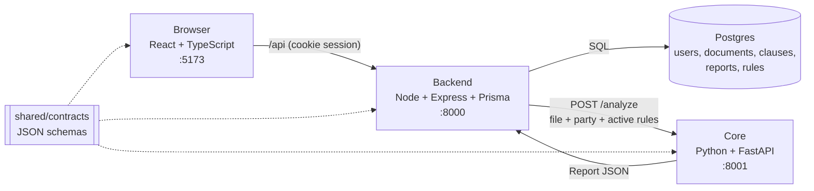

# Legal Document Summarizer

A semester project. You upload a contract (a text file or a text-based PDF) and say which side you are on (tenant, employee, client, ...). The app splits it into clauses, matches each clause against a set of rules, and shows the biggest risks, the obligations and the exit conditions, with the rule behind every result. A lawyer can override a score, and an admin can edit the rules.

It is rule-based, not machine learning, and it is **not legal advice**. Read [docs/known-limitations.md](docs/known-limitations.md) before trusting any number.

## Architecture



Core pipeline: `parse` -> `segment` -> `classify` (rules) -> `score` (for your side) -> `report`. Rules live in the database (seeded once from `core/rules/rules.json`), and the backend sends the active ones to core with every analysis.

## Run it from a fresh clone

You need: **Python 3.11+**, **Node 20+** (Node 22 or newer is fine), **git**, and a **Postgres database** (a free [Supabase](https://supabase.com) project is the easiest; a local Postgres 16 also works).

### 1. Get the code and install

Linux or macOS:

```bash
git clone <repo-url> legal-document-summarizer
cd legal-document-summarizer
python3 -m venv .venv && source .venv/bin/activate
python -m pip install -r core/requirements.txt
(cd backend/api && npm install)
(cd frontend && npm install)
```

Windows (PowerShell):

```powershell
git clone <repo-url> legal-document-summarizer
cd legal-document-summarizer
python -m venv .venv; .\.venv\Scripts\Activate.ps1
python -m pip install -r core\requirements.txt
cd backend\api; npm install; cd ..\..
cd frontend; npm install; cd ..
```

### 2. Configure (your own secrets, never committed)

```bash
cp backend/api/.env.example backend/api/.env      # Windows: copy backend\api\.env.example backend\api\.env
cp frontend/.env.example frontend/.env            # Windows: copy frontend\.env.example frontend\.env
```

Edit `backend/api/.env`:

- `DATABASE_URL` and `DIRECT_URL`: your Postgres connection strings. For Supabase use the **pooler** hosts from the project's Connect page (port 6543 for `DATABASE_URL` with `?pgbouncer=true`, port 5432 for `DIRECT_URL`). The `db.<ref>.supabase.co` host is IPv6-only and often unreachable. URL-encode special characters in the password (`#` becomes `%23`). For a local Postgres without TLS also set `DB_SSL=false`.
- `JWT_SECRET`: a random string of at least 32 characters. Make one with:
  `node -e "console.log(require('crypto').randomBytes(48).toString('hex'))"`

### 3. Create the tables

```bash
cd backend/api
npm run prisma:generate
npm run db:push
cd ../..
```

### 4. Start everything

Linux or macOS: `./scripts/start-all.sh`
Windows: `.\scripts\start-all.ps1`

It starts core (8001), the backend (8000) and the frontend (5173), waits for each health check, and prints the URLs. The backend fills the rules table from `core/rules/rules.json` the first time it starts. Press Ctrl+C to stop all three.

### 5. Add demo data (in a second terminal, same virtual environment)

```bash
python scripts/demo-seed.py
```

This creates three **local demo accounts** and analyses two sample contracts. The demo passwords are public and for a local demo only; never use them anywhere real.

| Role | Email | Password |
|---|---|---|
| user | `demo.user@example.com` | `DemoUser-2026!` |
| lawyer | `demo.lawyer@example.com` | `DemoLawyer-2026!` |
| admin | `demo.admin@example.com` | `DemoAdmin-2026!` |

Check the whole stack with `python scripts/smoke-test.py` (13 checks, about 15 seconds).

## No database? Offline demo mode

For teammates who only need to run or work on the app (frontend, docs, demos) and should not get the database password. No `.env`, no Supabase and no database are needed:

```bash
./scripts/start-all.sh --offline          # Windows: .\scripts\start-all.ps1 -Offline
python scripts/demo-seed.py --offline     # optional: uploads and analyses two sample contracts
```

- The backend keeps everything in memory (users, documents, reports, rules) and **loses it when it stops**.
- It creates the three public demo accounts from the table above at start-up, and the login page shows them with "Fill in" buttons.
- Core still does the real analysis, so reports, lawyer overrides and the rules admin all work.
- It refuses to start with `NODE_ENV=production`. Never deploy this mode: the accounts and passwords are public.
- It does **not** test the real database. Whoever works on the backend still needs a database of their own (a free Supabase project or a local Postgres).

## Demo script: 5 steps to click through

1. **Sign in** as the demo user at http://localhost:5173. Open **Documents** and click **Open report** on `rental_landlord_friendly.txt`. Show the Top 5 risks, each with its rule id and score (red, amber and green also carry an icon and a word).
2. **Filter and explain.** In **All clauses** filter by "Penalty" and "High risk", and open "Why this was flagged" on a clause.
3. **Analyze a new file.** Open **Analyze**, drop in `core/data/samples/employment_1.txt`, choose **Employee**, and submit. Then try `core/data/samples/scanned_sample.pdf` and show the clear "looks scanned" message.
4. **Lawyer override.** Sign out, sign in as the lawyer, open **Documents** > **Review**, override a clause score with a reason, and show that the original auto score is kept. Sign back in as the user: the report shows the override next to the automatic score.
5. **Change a rule.** Sign in as the admin, open **Rules**, switch off `PEN-004` (or add a rule, see [docs/viva-notes.md](docs/viva-notes.md)), then as the user click **Analyze again** and show the report changed. Try adding the pattern `(a+)+$` to show the server refuses it.

## Tests

| What | Command |
|---|---|
| Core (28 tests) | `python -m pytest core/tests` |
| Backend (23 tests, no database needed) | `cd backend/api && npm test` |
| Frontend type check and build | `cd frontend && npm run build` |
| Whole stack (13 checks) | `python scripts/smoke-test.py` (stack must be running) |
| One clause, every stage | `python -m core.cli core/data/samples/rental_landlord_friendly.txt --party tenant --trace` |
| Rules on a labelled set | `python -m core.eval.evaluate` |

The 8 submission test cases, with real results, are in [tests/test-cases.md](tests/test-cases.md).

## Team and ownership

| Path | Owner |
|---|---|
| `core/`, `shared/`, root files | Varun |
| `backend/` | Abhishek |
| `frontend/` | Harnoor |
| `docs/` | Daksh |
| `tests/` | Shaurya |

How we work is in [CONTRIBUTING.md](CONTRIBUTING.md) and [OWNERS.md](OWNERS.md). Lanes talk only through the schemas in `shared/contracts/`, never by importing each other's code.

## Documentation

- [docs/known-limitations.md](docs/known-limitations.md): what it does not do, and what the numbers do not prove
- [docs/viva-notes.md](docs/viva-notes.md): architecture, a traced clause, how to add a rule live, likely questions
- [docs/security/audit.md](docs/security/audit.md) and [backend-issues.md](docs/security/backend-issues.md): security review
- [frontend/DESIGN.md](frontend/DESIGN.md): the design spec
- [core/README.md](core/README.md), [backend/README.md](backend/README.md), [frontend/README.md](frontend/README.md): per-lane details
- [tests/test-cases.md](tests/test-cases.md): the submission test cases

## If something does not start

- **Backend says `Environment validation failed`**: `backend/api/.env` is missing a value (`DATABASE_URL`, `JWT_SECRET`).
- **`ENOTFOUND db.xxxx.supabase.co`**: use the pooler host (step 2).
- **"The database is not reachable" (503), or start-all says the backend cannot reach the DATABASE**: a free Supabase project pauses after about a week without use. Open the Supabase dashboard and click **Restore project**, then check `DATABASE_URL` in `backend/api/.env`.
- **"Cannot reach the API at http://localhost:8000"** on the login page: the backend is not running, or `VITE_API_URL` is wrong. Run `scripts/start-all`, open http://localhost:8000/api/health, and read `.run/backend.log`.
- **The app says "analysis service is not running"**: core on port 8001 is not up; see `.run/core.log`.
- **Port already in use**: stop the old process (`netstat -ano | findstr :8000` on Windows, `lsof -i :8000` elsewhere).
